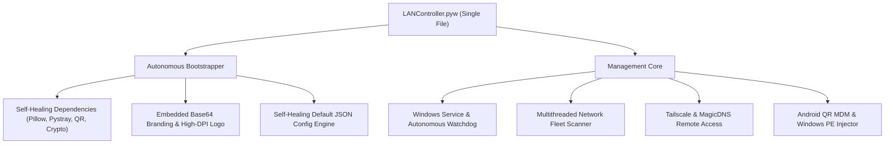

# LANController

> **Enterprise-Grade Autonomous Fleet & Mobile Device Management (MDM) Controller**  
> *Fully All-Inclusive • Fully Standalone • Fully Self-Healing Single `.pyw` Executable*

[](https://microsoft.com)
[](https://python.org)
[-0a84ff.svg)](https://github.com/balajifinancemachine-lab/LANCONTROLLER)
[](https://github.com/balajifinancemachine-lab/LANCONTROLLER)
[](LICENSE)

---

## 🌟 Overview

**LANController** is an enterprise-ready, all-in-one standalone Windows administration console, background system tray daemon, and fleet management controller. 

Designed for systems engineers, network administrators, and IT managers, LANController operates as a **single, fully all-inclusive `.pyw` file (`LANController.pyw`)**. It requires **zero external installers, zero setup wizards, and zero manual dependency wiring**. Just copy `LANController.pyw` onto any Windows machine and double-click.



---

## ⚡ Key Architectural Capabilities

### 1. 🛡️ Autonomous Self-Healing & Zero-Crash Architecture
- **Dependency Auto-Healer**: Automatically verifies required libraries (`pillow`, `pystray`, `qrcode`, `cryptography`) and quietly installs them on first launch if missing.
- **Offline Fallbacks**: Includes complete pure-Python and native Tkinter fallback modes. Even on an air-gapped machine without internet or `pip`, the application runs with zero crashes.
- **Embedded Assets**: High-resolution branding and logos are embedded directly inside the code via Base64; automatically extracts or renders directly from memory.
- **Self-Healing Configuration**: Detects missing or corrupted `config.json` files and auto-generates a secure, cryptographically keyed production configuration.
- **Service Watchdog**: Continuously polls server health and automatically revives the service or node process if terminated unexpectedly.

### 2. 🖥️ Executive Apple Human Interface Design Theming
- **Dynamic Theming**: Fluid Apple iOS Dark Mode & Light Mode switcher with curated color tokens.
- **Windows DWM Immersive Titlebar**: Direct Windows 10/11 Desktop Window Manager (DWM) integration with dark/light titlebars.
- **DPI-Aware & Responsive**: True per-monitor DPI awareness v2 (`SetProcessDpiAwareness`) with dynamic PanedWindow layout.

### 3. 🌐 Enterprise Network Fleet Scanner
- **Fast Non-Blocking Discovery**: Concurrent ARP cache inspection, parallel ICMP sweeps, and multi-threaded DNS reverse resolution.
- **Adapter Prioritization**: Intelligently identifies active physical Ethernet and Wi-Fi adapters over virtual/hypervisor interfaces.
- **Export Capabilities**: 1-click export of discovered network fleet nodes to CSV.

### 4. 🚀 Tailscale & Direct Remote Access
- **Tailscale Serve**: 1-click HTTPS reverse-proxying through private Tailscale networks.
- **MagicDNS Routing**: Remote access from anywhere in the world using private MagicDNS hostnames with zero router port forwarding.
- **Android Mobile QR Pairing**: Instant QR code generation on-screen for 10-second Android remote control enrollment.

### 5. 📦 Endpoint Deployment & PE Policy Injection
- **Binary Header Injection**: Directly injects `.msh` connection policies into standard PE32 and PE32+ (64-bit) Windows agent binaries.
- **Standard User & Service Modes**: Distribute 1-click portable clients for standard users or full unattended background Windows Services for permanent administrative control.

---

## 📁 Repository Structure

```
LANCONTROLLER/
│
├── LANController.pyw         # PRIMARY STANDALONE ALL-INCLUSIVE EXECUTABLE
├── lancontrol_manager.pyw    # Backward-compatible proxy launcher
├── lancontrol_logo.png       # Application high-resolution logo
├── config.json               # Production configuration template
├── REMOTE_ACCESS_GUIDE.md    # Multi-device remote setup manual
├── README.md                 # Complete system documentation
├── .gitignore                # Optimized repository ignore rules
│
└── tests/
    └── test_lancontroller.py # Automated pytest regression suite
```

---

## 🚀 Quick Start

### Running LANController
Double-click `LANController.pyw` or run via terminal:

```powershell
pythonw LANController.pyw
```

### CLI Command Options

| Argument | Description |
| :--- | :--- |
| `LANController.pyw` | Launch full interactive management console (auto-elevates to Admin if needed). |
| `--tray` | Start directly minimized into the Windows System Tray. |
| `--autostart` | Windows user login mode (waits for server health, launches Web UI in browser, docks to tray). |
| `--setup` | Force launch setup and configuration manager interface. |
| `--no-elevate` | Bypass automatic UAC elevation prompt and run in standard user mode. |

---

## 🧪 Automated Testing & Verification

Run the test suite to verify standalone integrity, embedded assets, and self-healing subsystems:

```powershell
pytest tests/test_lancontroller.py -v
```

All 8 tests verify:
- Application metadata and symbol exports (`__all__`).
- Embedded PNG header signature validity (`\x89PNG\r\n\x1a\n`).
- Self-healing logo disk extraction.
- Cryptographically secure 64-char session key generation.
- Default configuration generation and JSON validation.
- LAN IP adapter detection.
- Non-blocking port collision detection.
- Atomic JSON read/write safety.

---

## 📄 License

This project is licensed under the [MIT License](LICENSE).
